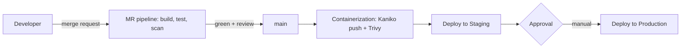
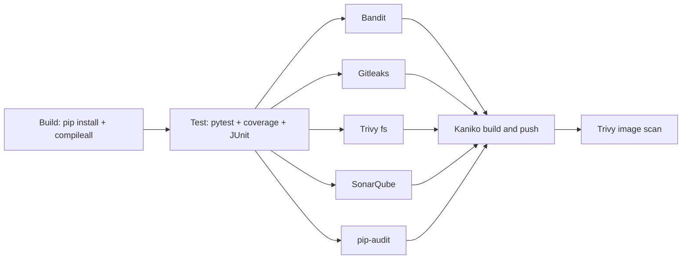

# Code-Keeper: Audit Guide

How to run the audit session for code-keeper, in the order of `docs/audit.md`: what to show, the
commands to run, what the output should look like, and how to answer the questions. `README.md` is
the reference for setup and configuration; this guide is for the session itself.

**What the auditor will see**

- A GitLab CE 19.5.0 instance on EC2, installed and configured by Ansible, with a group
  `code-keeper` that holds four repositories: `infra`, `api-gateway`, `inventory-app` and
  `billing-app`, each with its own pipeline.
- A GitLab Runner on a second EC2 host, installed and registered by Ansible, running every job of
  all four pipelines.
- Two AWS environments, staging and production, created by the `infra` pipeline with Terraform,
  running the three services on ECS Fargate behind a load balancer.

---

## Contents

0. [Before the session](#0-before-the-session)
1. [Repository content review](#1-repository-content-review)
2. [Stakeholder roleplay](#2-stakeholder-roleplay)
3. [GitLab and runners deployment](#3-gitlab-and-runners-deployment)
4. [Infrastructure pipeline](#4-infrastructure-pipeline)
5. [CI pipeline](#5-ci-pipeline)
6. [CD pipeline](#6-cd-pipeline)
7. [Pipeline functionality and live testing](#7-pipeline-functionality-and-live-testing)
8. [Cybersecurity guidelines](#8-cybersecurity-guidelines)
9. [Documentation review](#9-documentation-review)
10. [Bonus defense](#10-bonus-defense)
11. [After the session](#11-after-the-session)

---

## 0. Before the session

The brief says the solution must be running during the audit. Bring everything up the day before
or at least two hours before, because the first infra apply takes 15 to 20 minutes per
environment.

### 0.1 Bring it up

| Step | Command or action | Time |
|---|---|---|
| GitLab hosts | `terraform -chdir=ansible/terraform apply -var 'admin_cidrs=["<your IP>/32"]'` (or start the stopped instances) | 2 min |
| GitLab and runner | `cd ansible && ansible-playbook playbooks/site.yml` with `GITLAB_ROOT_PASSWORD` and the `CK_` values exported | 15 min the first time, 3 min after |
| Repositories | `GITLAB_URL=... scripts/publish_repos.sh` (only if the projects are new or behind) | 1 min |
| Infrastructure | `code-keeper/infra`: Build > Pipelines > Run pipeline on `main`, then run `infra:approval:production` | 40 min |
| Applications | each app project: Run pipeline on `main`, then run `<app>:approval:production` | 15 min each, in parallel |

### 0.2 Check it is ready

```bash
# GitLab answers and the runner is online
curl -s -o /dev/null -w '%{http_code}\n' "$(terraform -chdir=ansible/terraform output -raw gitlab_url)/users/sign_in"
cd ansible && ansible gitlab_runners -b -m command -a 'gitlab-runner verify'

# Both environments serve traffic
for env in staging production; do
  DNS=$(aws elbv2 describe-load-balancers --names "code-keeper-${env}-alb" --query 'LoadBalancers[0].DNSName' --output text)
  echo "$env: $(curl -s "http://${DNS}/health")"
done
```

Expected: `200`, `Verifying runner... is valid`, and `{"status":"healthy"}` twice. In GitLab, the
latest pipeline of each of the four projects is green.

### 0.3 Have open

- A terminal in `ansible/` (for `ansible-playbook` and SSH to the hosts).
- GitLab in the browser, logged in as root, on the `code-keeper` group page.
- The AWS console on ECS (us-east-1), or the AWS CLI with the `code-keeper` profile.
- This guide and `docs/audit.md`.

---

## 1. Repository content review

### 1.1 Are all the required files present?

| Required by the audit | File(s) |
|---|---|
| CI/CD pipeline configuration files | `infra/.gitlab-ci.yml`, `srcs/api-gateway/.gitlab-ci.yml`, `srcs/inventory-app/.gitlab-ci.yml`, `srcs/billing-app/.gitlab-ci.yml` |
| Scripts and other artefacts | `scripts/publish_repos.sh`, `scripts/test_pipelines.sh`, `scripts/verify_security.sh`, `scripts/audit_orchestrator.sh`, the Dockerfiles, `infra/` (Terraform), `ansible/terraform/` (GitLab hosts) |
| Ansible playbook and scripts for GitLab | `ansible/playbooks/site.yml`, `deploy-gitlab.yml`, `deploy-runners.yml`; roles `gitlab`, `gitlab_api_token`, `gitlab_runner`; `ansible/scripts/setup-gitlab.sh`, `ansible/scripts/register-runner.sh` |
| README explaining design, tools, setup and use | `README.md` |

Show the tree briefly:

```bash
ls ansible/playbooks ansible/roles infra srcs scripts
```

Explain the layout in one sentence: the submission is one repository with four folders, and
`scripts/publish_repos.sh` publishes each folder, with its own history, to its own GitLab project,
which is where the pipelines run. Then open the `code-keeper` group in GitLab to show the four
projects.

---

## 2. Stakeholder roleplay

Present the solution in two minutes first, then take the questions. Keep each answer to what was
actually built; the auditor checks understanding, not slogans.

### 2.1 The two-minute pitch

"Developers work in four GitLab repositories: one for the infrastructure and one per service. Every
merge request runs the checks: tests and security scans for the apps, Terraform validation and an
IaC scan for the infrastructure. A merge is only possible when they pass. On `main`, the app
pipelines build an image with Kaniko, scan it, deploy it to staging on ECS, and after a manual
approval roll it out to production without downtime. The infra pipeline plans, applies to staging,
and applies the same reviewed plan to production after approval. GitLab and its runner are
installed by Ansible on EC2, and Ansible also creates the projects, the merge rules, the CI/CD
variables and the runner, so the whole platform can be rebuilt from this repository."



### 2.2 The sixteen questions

#### Question 1: Can you explain the concept of DevOps and its benefits for the software development lifecycle?

DevOps joins development and operations into one delivery process with shared ownership and
automation from commit to production. Changes are small, tested automatically and released often.
Benefits: shorter lead time, fewer failed releases, faster recovery, and a record of every change.
In this project a commit reaches staging without anyone touching a server, and production after
one approval.

#### Question 2: How do DevOps principles help improve collaboration between development and operations teams?

Shared tools and shared rules. Developers and operators use the same repositories and merge
requests; the rules for releasing (scans, approval, deployment) are code in `.gitlab-ci.yml` that
everyone can read and change through review. Infrastructure changes go through the `infra`
repository with the same process as application changes.

#### Question 3: What are some common DevOps practices, and how did you incorporate them into your project?

- Version control for everything: code, pipelines, Terraform, Ansible.
- Continuous integration: every merge request runs build, test and scans.
- Continuous delivery: `main` deploys to staging automatically and to production after approval.
- Infrastructure as code: Terraform modules for both environments.
- Configuration management: Ansible for GitLab and the runner.
- DevSecOps: Bandit, Gitleaks, Trivy and pip-audit inside the pipelines.
- Immutable artefacts: images tagged with their commit SHA.

#### Question 4: How does automation play a key role in the DevOps process, and what tools did you use to automate different stages of your project?

Automation makes every run identical and fast, and removes the manual steps where mistakes
happen. Terraform creates the cloud resources; Ansible installs and configures GitLab and the
runner (including the projects and variables, through the GitLab API); GitLab CI runs the
pipelines; Kaniko builds images without a Docker daemon; crane promotes images in the registry;
the AWS CLI updates the ECS services.

#### Question 5: Can you discuss the role of continuous integration and continuous deployment (CI/CD) in a DevOps workflow, and how it helps improve the quality and speed of software delivery?

CI tests every change before it is merged, so `main` stays releasable and problems are found when
they are cheap to fix. CD turns every merge into a release candidate that goes through the same
steps every time. Quality improves because nothing skips the checks; speed improves because
releasing is a button, not a project.

#### Question 6: Can you explain the importance of infrastructure as code (IaC) in a DevOps environment, and how it helps maintain consistency and reproducibility in your project?

The infrastructure is described in files that are reviewed, versioned and applied by a pipeline,
so it never drifts from what is written. Staging and production use the same five modules with
different variable files, so staging is a real replica of production. Both environments can be
destroyed and rebuilt from the repository, which is also how costs are kept down here.

#### Question 7: How do DevOps practices help improve the security of an application, and what steps did you take to integrate security into your development and deployment processes?

Security checks run on every change instead of once before a release. Steps taken: protected
`main`, protected and masked CI/CD variables, credential-free merge request pipelines, Bandit,
Gitleaks, Trivy (code, dependencies, images, Terraform), pip-audit, an unprivileged runner and
non-root containers, security groups that only allow the next hop, secrets in AWS Secrets Manager,
and a manual approval before production.

#### Question 8: What challenges did you face when implementing DevOps practices in your project, and how did you overcome them?

- **AWS Free plan limits.** The first applies failed: at most 1 day of RDS backups, and at most 2
  RDS instances in the account, while the two environments need 4. Backups were set to 1 day and
  the account moved to the paid plan.
- **Building images on an unprivileged runner.** Docker-in-Docker needs a privileged runner, so
  images are built with Kaniko.
- **Tool images without a shell.** The `crane` images have no shell, which GitLab needs, so the
  pipeline uses crane's debug image pinned by digest.
- **Runner registration.** GitLab 17 disabled registration tokens by default; the runner is now
  created through the API and registered with an authentication token.
- **Splitting the repository.** The four pipelines had been one merged monorepo pipeline; each was
  rewritten to stand alone, and the folders are published with `git subtree split`.

#### Question 9: How can DevOps practices help optimize resource usage and reduce costs in a cloud-based environment?

Sizes are Terraform variables, so staging stays small and production can grow without code
changes. Because everything is code, environments can be destroyed after use and rebuilt for the
next session; that is how this project fits its budget. Fargate bills per running task, and the
GitLab hosts can be stopped when idle.

#### Question 10: Can you explain the purpose and benefits of using GitLab and GitLab Runners in your project, and how they improve the development and deployment processes?

GitLab holds the code, merge requests, reviews, CI/CD variables, pipelines and their history in
one place, with permissions per group and project. The runner executes jobs on a separate host,
each job in a fresh container, so builds are reproducible, cannot affect the GitLab server, and
capacity grows by adding runners.

#### Question 11: What are the advantages of using Ansible for automation in your project, and how did it help you streamline the deployment of GitLab and GitLab Runners?

Ansible is agentless (SSH and Python only), idempotent, and its playbooks read like a runbook. One
command installs pinned versions of GitLab and the runner, writes their configuration, applies the
GitLab settings, creates the group, projects, members and CI/CD variables, and registers the
runner. Running it again changes nothing unless something drifted.

#### Question 12: Can you explain the concept of Infrastructure as Code (IaC) and how you implemented it using Terraform in your project?

IaC means describing infrastructure declaratively and letting a tool converge reality to it.
Terraform modules: `vpc`, `security_groups`, `rds`, `rabbitmq`, `compute` (ALB, ECS, IAM roles,
Secrets Manager, logs). Two root modules (`environments/staging`, `environments/production`) call
them with their own variables. State lives in S3 with DynamoDB locking; the pipeline saves a plan
and applies exactly that plan.

#### Question 13: What is the purpose of using continuous integration and continuous deployment (CI/CD) pipelines, and how did it help you automate the building, testing, and deployment of your application?

To make building, testing and releasing repeatable and visible. Here a push builds and tests the
service, scans it, packages it as an image tagged with the commit, deploys it to staging, and
after one approval deploys it to production, with each step's log kept in GitLab.

#### Question 14: How did you ensure the security of the application throughout the pipeline stages?

- Build and Test: clean containers per job, pinned dependencies.
- Scan: Bandit (code), Gitleaks (secrets), Trivy (dependencies), pip-audit (advisories),
  SonarQube when configured.
- Containerization: Kaniko without privileges; Trivy scans the pushed image and blocks on HIGH or
  CRITICAL; non-root user in the image.
- Deploy: only on protected `main` with protected variables; the deploy job checks the image exists
  before touching ECS; production needs a manual approval.

#### Question 15: Can you explain the continuous integration (CI) pipeline you've implemented for each repository?

Build installs the requirements and compiles the code. Test runs pytest with coverage and a JUnit
report. Scan runs Bandit, Gitleaks, Trivy, SonarQube and pip-audit in parallel. Containerization
builds the image with Kaniko; on `main` it pushes `<service>:<commit SHA>` to Docker Hub and Trivy
scans it, on a merge request it only builds. Show it in GitLab on the latest pipeline of
`code-keeper/api-gateway`.

#### Question 16: Can you explain the continuous deployment (CD) pipeline you've implemented for each repository?

Deploy to Staging registers a new ECS task definition revision with the commit image, updates the
service, waits until it is stable, and for the gateway checks `/health` through the load
balancer. Approval is a manual, blocking job. Deploy to Production copies the image to the
`production-latest` alias and performs the same rolling update on the production cluster. ECS
keeps 100 % of the tasks healthy during the update (maximum 200 %), so there is no downtime.

### 2.3 What the auditor evaluates

#### Do all of the students have a good understanding of the concepts and technologies used in the project?

Answer from this project, not from definitions: "we use Kaniko because the runner is
unprivileged", "the plan is saved so production gets exactly the reviewed change". Every team member
should be able to explain any of the four pipelines and the Ansible run.

#### Do all of the students have the ability to communicate effectively and explain their decisions?

Show the thing while explaining it: the pipeline graph, the job log, the rule in the YAML, the
running task definition. Give the reason for each decision, and the trade-off it accepted.

#### Are all of the students capable of thinking critically about their solution and considering alternative approaches?

Know the alternatives and the limits:

- EKS instead of ECS: more control, more to run and pay for.
- ECR instead of Docker Hub: IAM instead of a token, but the registry would be tied to AWS.
- Renovate for automated updates: not set up; Trivy and pip-audit only detect.
- A narrower IAM policy for the pipelines, and a deploy-only key for the app projects.
- TLS once there is a domain.

Section 12 of `README.md` lists the known limitations.

---

## 3. GitLab and runners deployment

**Audit questions: Was the GitLab instance deployed and configured successfully using Ansible?
Are the GitLab Runners integrated with the existing pipeline and executing tasks as expected for
all repositories?**

### 3.1 Show the playbooks

```bash
cd ansible
ansible-playbook playbooks/site.yml --list-tasks
```

The output lists three plays: GitLab (install, `gitlab.rb`, readiness, API token, instance
settings, group and projects, members, CI/CD variables), the API token for the runner play, and the
runner (Docker, pinned gitlab-runner, registration through the API, `config.toml`, verification).
Point out:

- `gitlab_version: "19.5.0-ce.0"` and `gitlab_runner_version: "19.5.0-1"` are pinned.
- No password or token is in the repository: `GITLAB_ROOT_PASSWORD` and the `CK_` values come from
  the environment; the API token is created per run and expires after a day.
- The runner is created with `POST /api/v4/user/runners` and registered with the returned `glrt-`
  authentication token; legacy registration tokens are not used.

Optionally prove idempotency by running it again: the only changes are the fresh one-day API
tokens (one in the GitLab play, one for the runner play); GitLab and the runner are untouched.

```bash
ansible-playbook playbooks/site.yml
```

### 3.2 Show the services on the hosts

```bash
ssh -i ~/.ssh/code-keeper ubuntu@<gitlab IP>
sudo gitlab-ctl status            # every service "run:"
systemctl status gitlab-runsvdir  # active (running)
sudo gitlab-rake gitlab:env:info  # GitLab 19.5.0
exit

ssh -i ~/.ssh/code-keeper ubuntu@<runner IP>
systemctl status gitlab-runner    # active (running)
sudo gitlab-runner list 2>&1 | sed -E 's/(Token[^=]*=)[^ ]+/\1<redacted>/'
                                  # docker-shared-runner-01, Executor=docker, Token=<hidden>
sudo gitlab-runner verify         # is valid
sudo grep -E 'privileged|executor|image' /etc/gitlab-runner/config.toml
exit
```

`terraform -chdir=ansible/terraform output` prints both SSH commands.

### 3.3 Show the configuration in GitLab

- Admin > Settings > General > Sign-up restrictions: sign-up disabled.
- Admin > Settings > Repository > Default branch: `main`, protected (Maintainers push and merge,
  no force push).
- Group `code-keeper` > Settings > CI/CD > Variables: the shared variables, masked and protected.
- Project `infra` > Settings > CI/CD > Variables: the Terraform state and password variables.
- Any project > Settings > Merge requests: "Pipelines must succeed" and "All threads must be
  resolved".
- Admin > CI/CD > Runners: the runner is online, with its tags.
- Any pipeline > any job: the log header shows `Running on runner-... via ip-...` and the executor
  `docker`.

**Answer to "accessible to all team members, supports collaboration and code reviews":** GitLab is
on a public address (port 80, `team_cidrs`), sign-up is closed and Ansible creates the team's
accounts in the group from `gitlab_team_members`; merge requests need a green pipeline and
resolved threads.

---

## 4. Infrastructure pipeline

**Audit questions: Did the student deploy the infrastructure for two environments using Terraform?
Are the two environments similar? Does the infrastructure configuration exist in an independent
repository with a configured pipeline? Are the six stages implemented correctly?**

### 4.1 Independent repository

`code-keeper/infra` in GitLab contains only the Terraform and its `.gitlab-ci.yml`; the pipeline
runs from that project. Show its history: it has its own commits.

### 4.2 The two environments

```
infra/
├── modules/{vpc,security_groups,rds,rabbitmq,compute}   shared by both
└── environments/
    ├── staging/      10.10.0.0/16   same modules, same sizes
    └── production/   10.20.0.0/16   same modules, same sizes
```

| | Staging | Production |
|---|---|---|
| ECS Fargate | 3 services x 2 tasks | same |
| RDS PostgreSQL 15 | inventory + billing, `db.t3.micro` | same |
| Amazon MQ RabbitMQ 4.2 | `mq.m7g.medium` | same |
| ALB, NAT gateway, flow logs, Secrets Manager, KMS | yes | yes |

Production is sized like staging for cost; `infra/environments/production/main.tf` records the HA
sizes. Show it live:

```bash
for env in staging production; do
  aws ecs describe-services --cluster "code-keeper-${env}-cluster" \
    --services code-keeper-${env}-api-gateway code-keeper-${env}-inventory-app code-keeper-${env}-billing-app \
    --query 'services[].[serviceName,runningCount,desiredCount]' --output table
done
aws rds describe-db-instances --query 'DBInstances[].[DBInstanceIdentifier,DBInstanceClass,DBInstanceStatus]' --output table
aws mq list-brokers --query 'BrokerSummaries[].[BrokerName,BrokerState,HostInstanceType]' --output table
```

### 4.3 The six stages

| Stage | Jobs | Notes |
|---|---|---|
| Init | `infra:init:staging`, `infra:init:production` | S3 backend with DynamoDB lock |
| Validate | `infra:validate:syntax`, `infra:validate:security`, `infra:validate:dependencies` | fmt, validate, Trivy IaC scan (blocking), provider report |
| Plan | `infra:plan:staging`, `infra:plan:production` | saved plans as artifacts |
| Apply to Staging | `infra:apply:staging` | automatic on `main`, applies the saved plan |
| Approval | `infra:approval:production` | `when: manual`, `allow_failure: false`: the pipeline waits |
| Apply to Production | `infra:apply:production` | needs the approval and the production plan |

Open the latest `infra` pipeline and show the graph, the plan output in `infra:plan:production`,
and who ran the approval. Init, Plan and Apply only run on `main`, because they need the protected
variables; merge requests run the Validate stage.

---

## 5. CI pipeline

**Audit question: Are the Build, Test, Scan, and Containerization stages implemented correctly in
the CI pipeline for each repository?**



| Stage | What to point at |
|---|---|
| Build | `python3 -m compileall -b .`, artifacts `requirements.txt` (and `openapi.yaml` for the gateway) |
| Test | the Tests tab of the pipeline (JUnit), the coverage percentage on the job |
| Scan | each scanner is its own job; Bandit, Gitleaks and Trivy block the pipeline on findings, pip-audit is advisory |
| Containerization | the Kaniko log ends with `Pushed docker.io/<repo>/<service>:<sha>`; the Docker Hub tag list shows the SHA tags |

The three app pipelines are identical apart from the service name, plus the gateway's extra
artifact and ALB health check. Show one in detail and the other two at a glance.

---

## 6. CD pipeline

**Audit question: Are the "Deploy to Staging", "Approval", and "Deploy to Production" stages
implemented correctly in the CD pipeline for each repository?**

| Stage | Job | What it does |
|---|---|---|
| Deploy to Staging | `<app>:deploy:staging` | checks the image exists, registers a task definition revision with `<sha>`, `aws ecs update-service`, `aws ecs wait services-stable`, gateway: `curl /health` through the ALB |
| Approval | `<app>:approval:production` | manual, blocking (`allow_failure: false`) |
| Deploy to Production | `<app>:promote:image` | `crane copy <sha> production-latest`, digests compared |
| Deploy to Production | `<app>:deploy:production` | same rolling update on the production cluster |

**Zero downtime:** the ECS services use `deployment_minimum_healthy_percent = 100` and
`deployment_maximum_percent = 200`. ECS starts the new tasks, waits for the container health check
and the load balancer health check, then drains the old ones. The job only succeeds when the
service is stable. Show it:

```bash
aws ecs describe-services --cluster code-keeper-production-cluster \
  --services code-keeper-production-api-gateway \
  --query 'services[0].{deployments:deployments[].[status,rolloutState,runningCount,taskDefinition],config:deploymentConfiguration}'
```

---

## 7. Pipeline functionality and live testing

**Audit question: Are the pipelines working properly and updating the application and
infrastructure after each modification in each repository?**

### 7.1 Change an application

1. In GitLab, open `code-keeper/inventory-app`, create a branch and edit a file, for example add a
   line to `server.py`'s module docstring or bump a comment. Open a merge request.
2. The merge request pipeline runs Build, Test, Scan and a build-only Containerization. Show that
   the Merge button waits for it.
3. Merge. The `main` pipeline pushes the new image, deploys staging, and stops at the approval.
4. Show staging runs the new commit:

   ```bash
   aws ecs describe-services --cluster code-keeper-staging-cluster --services code-keeper-staging-inventory-app \
     --query 'services[0].taskDefinition' --output text | xargs -I{} aws ecs describe-task-definition \
     --task-definition {} --query 'taskDefinition.containerDefinitions[0].image' --output text
   ```

   The tag equals the merge commit's short SHA.
5. Run the approval; production gets the same image. Repeat the command with `production`.
6. Prove the service still works:

   ```bash
   ALB=$(aws elbv2 describe-load-balancers --names code-keeper-production-alb --query 'LoadBalancers[0].DNSName' --output text)
   curl -s -X POST "http://${ALB}/api/movies" -H 'Content-Type: application/json' -d '{"title":"Audit","description":"live test"}'
   curl -s "http://${ALB}/api/movies?title=Audit"
   curl -s -X POST "http://${ALB}/api/billing" -H 'Content-Type: application/json' -d '{"user_id":"1","number_of_items":"2","total_amount":"9.99"}'
   ```

### 7.2 Change the infrastructure

A visible, harmless change: add a tag in `infra/environments/staging/main.tf` and
`infra/environments/production/main.tf` (or change the CloudWatch log retention), through a merge
request. The merge request pipeline runs Validate; after the merge, `infra:plan:*` shows exactly
that change, staging applies it, and production applies it after the approval. Show the result in
the AWS console or with `aws` describe commands.

### 7.3 Local checks

```bash
scripts/test_pipelines.sh     # ends with "ALL CODE-KEEPER PIPELINE TESTS PASSED!"
scripts/verify_security.sh    # one known false positive, see section 8.5
```

---

## 8. Cybersecurity guidelines

### 8.1 Restrict triggers to protected branches

**Audit question: Are triggers restricted to protected branches, ensuring unauthorized users cannot
deploy or tamper with the application?**

- Show any project > Settings > Repository > Protected branches: `main`, Maintainers only, no force
  push.
- Show the rules in a pipeline file: every push, apply and deploy job has
  `if: $CI_COMMIT_BRANCH == "main"`.
- Show that the deploy credentials are **protected** variables: GitLab only passes them to
  protected branches, so even a modified pipeline on another branch cannot deploy.
- Show a merge request pipeline: it has no deploy jobs.

Be ready for: "the workflow also runs on other branches". Yes, on purpose: the brief wants CI on
every push and merge request. What is restricted is everything that can change the environments.

### 8.2 Separate credentials from code

**Audit question: Have the students separated credentials from code, using secure methods like
secret management tools or environment variables?**

- Group and project CI/CD variables, masked and protected, created by Ansible from the operator's
  environment.
- Terraform receives the passwords as `TF_VAR_*`, marked `sensitive`, and stores them in AWS
  Secrets Manager; ECS injects each into its container (`valueFrom` in the task definitions).
- `GITLAB_ROOT_PASSWORD` comes from the environment; the Ansible API token is generated per run and
  expires after a day; the runner token is only in `/etc/gitlab-runner/config.toml` (mode 600).
- Gitleaks runs in every app pipeline; `.gitignore` covers state, plans, keys and `.env`.

```bash
grep -rnE "password|secret|token" infra/environments/*/terraform.tfvars ansible/roles/*/defaults/main.yml
```

### 8.3 Apply the least privilege principle

**Audit question: Did the students apply the least privilege principle to limit user and service
access to the minimum required level?**

- Runner: `privileged = false`, no Docker socket in jobs, Kaniko for builds.
- Containers: `USER appuser` (UID 10001).
- Network: ALB from the internet only; gateway only from the ALB; inventory only from the gateway;
  databases only from their service; RabbitMQ only from the gateway and billing.
- ECS execution role: may read only this environment's secrets.
- GitLab hosts: SSH only from `admin_cidrs`; the runner accepts nothing else; IMDSv2; encrypted
  disks. GitLab: private group, sign-up disabled, members are Developers by default, infra-only
  variables on the infra project only.
- Be open about the gap: the pipelines' IAM user has `AdministratorAccess`. Terraform creates IAM
  roles, which already allows escalation, but a policy limited to the managed services is the next
  step, and the app projects could use a deploy-only key.

### 8.4 Update dependencies and tools regularly

**Audit question: Do the students have a process for updating dependencies and tools regularly,
automating updates, and monitoring for security advisories and patches?**

- Pinned versions, so updates are explicit, reviewed changes: GitLab, the runner, providers (lock
  files), Python requirements, Bandit and pip-audit, Kaniko, crane (by digest). The Trivy,
  Gitleaks, SonarQube and AWS CLI images still use `:latest`; say that pinning them is the next
  step.
- Advisories monitored on every pipeline: Trivy (dependencies, image, IaC), pip-audit, Bandit,
  Gitleaks; `scan:dependencies` also runs on scheduled pipelines (Build > Pipeline schedules).
- `infra:validate:dependencies` prints the locked provider versions, the newest the constraints
  allow and the newest released (for example aws 5.100.0 locked, 6.69.1 released).
- `.github/dependabot.yml` defines the update policy; on GitLab the equivalent bot is Renovate,
  which is not set up. Say so.

### 8.5 Known findings

`scripts/verify_security.sh` reports one failure, a false positive: it reads the secret names in
`infra/modules/compute/main.tf` (`"inventory-db-password"`, ...) as a hardcoded credential. They are
names, not values.

---

## 9. Documentation review

**Audit questions: Does the README.md file contain all the necessary information about the
solution? Is the documentation clear and complete, including well-structured diagrams and thorough
descriptions?**

`README.md` covers, in order: what is where (mapped to the brief), architecture with diagrams (AWS
environment, GitLab platform, pipeline design), directory structure, prerequisites, first-time
setup in five steps, day-to-day usage, every pipeline job, the configuration reference (CI/CD
variables, Ansible, Terraform), security, verification commands, costs and teardown, known
limitations, the sixteen role-play answers and the bonus items. `docs/AWS_SETUP.md` has the full
AWS walkthrough.

---

## 10. Bonus defense

### 10.1 Did the student implement any feature or anything that you would consider a bonus?

| Bonus | Evidence |
|---|---|
| IaC security scan with Trivy, which replaced tfsec (tfsec itself is not used) | `infra:validate:security`: `trivy config`, blocking on HIGH and CRITICAL, accepted findings documented in `.trivyignore` |
| The GitLab platform itself as code | `ansible/terraform/` creates the hosts; Ansible configures GitLab through its API (group, projects, merge rules, members, variables, runner) |
| Local verification tooling | `scripts/test_pipelines.sh`, `scripts/verify_security.sh`, `scripts/audit_orchestrator.sh` |
| Unprivileged builds | Kaniko on a non-privileged runner, build-only on merge requests |
| API documentation | Swagger UI at `http://<ALB>/docs`, spec at `/openapi.yaml` |

Not done, and fine to say so: Infracost and Terragrunt.

### 10.2 Did the student use their own crud-master source code?

The three services in `srcs/` are the team's crud-master application: a Flask gateway that proxies
the movies API and publishes billing orders to RabbitMQ, an inventory service with PostgreSQL, and
a billing worker that consumes the queue into its own database, each with its tests. They were
brought into this repository in commit `893eb44`.

### 10.3 Is this project an outstanding project?

That is the auditor's call. What to point at: every required part runs for real (GitLab installed
by Ansible, two AWS environments, four independent pipelines), the security scans are blocking
gates, production deploys are zero-downtime rolling updates behind a manual approval, and the
known limitations are written down rather than hidden.

---

## 11. After the session

Take everything down, or the account keeps paying for it (about $0.93 an hour with the GitLab
hosts):

```bash
# production first, then staging (from infra/environments/<env>, see docs/AWS_SETUP.md step 13)
terraform destroy
# then the GitLab hosts
terraform -chdir=ansible/terraform destroy -var 'admin_cidrs=["<your IP>/32"]'
```

Then run the leftover checks in `docs/AWS_SETUP.md` step 14.
