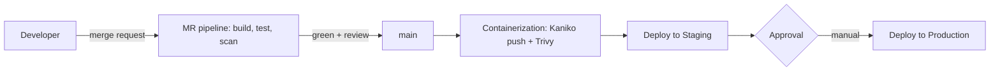
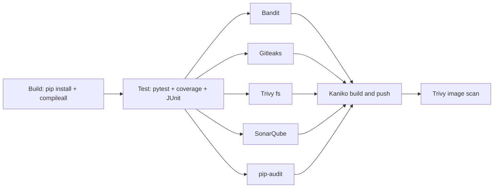

# Code-Keeper: Audit Guide

What to do during the audit session, question by question, in the order of `docs/audit.md`. Each
question has the same parts:

- **Show:** the exact clicks and commands.
- **Expect:** what the output looks like.
- **Say:** the answer in a few sentences.
- **If asked:** the follow-up questions to expect, with answers.

The expected outputs come from the live system on 2026-10-21: the first pipelines of the four
GitLab projects, both AWS environments and the two GitLab hosts. `README.md` is the reference for
setup and configuration; this guide is for the session itself.

**What the auditor will see**

- A GitLab CE 19.5.0 instance on EC2, installed and configured by Ansible, with a private group
  `code-keeper` that holds four repositories: `infra`, `api-gateway`, `inventory-app` and
  `billing-app`, each with its own pipeline.
- A GitLab Runner 19.5.0 on a second EC2 host, installed and registered by Ansible, running every
  job of all four pipelines in Docker containers.
- Two AWS environments, staging and production, created by the `infra` pipeline with Terraform,
  running the three crud-master services on ECS Fargate behind a load balancer, with PostgreSQL on
  RDS and RabbitMQ on Amazon MQ.

---

## Contents

0. [Before the session](#0-before-the-session)
1. [Repository content review](#1-repository-content-review)
2. [Stakeholder roleplay](#2-stakeholder-roleplay)
3. [GitLab and runners deployment](#3-gitlab-and-runners-deployment)
4. [Infrastructure pipeline](#4-infrastructure-pipeline)
5. [CI pipeline](#5-ci-pipeline)
6. [CD pipeline](#6-cd-pipeline)
7. [Pipeline functionality and live testing](#7-pipeline-functionality-and-live-testing)
8. [Cybersecurity guidelines](#8-cybersecurity-guidelines)
9. [Documentation review](#9-documentation-review)
10. [Bonus defense](#10-bonus-defense)
11. [After the session](#11-after-the-session)
12. [Quick reference](#12-quick-reference)
13. [If something goes wrong](#13-if-something-goes-wrong)

---

## 0. Before the session

The subject says the solution must be running during the audit. Bring everything up the day
before. From a torn-down account this takes about an hour (`docs/AWS_SETUP.md` step 12).

### 0.1 The day before

1. **Bring it up**, if it was torn down:

   | Step | Command or action | Time |
   |---|---|---|
   | GitLab hosts | `terraform -chdir=ansible/terraform apply -var 'admin_cidrs=["<your IP>/32"]'`, or start the two stopped instances | 2 min |
   | GitLab and runner | `source ~/.config/code-keeper.env`, then `cd ansible && ansible-playbook playbooks/site.yml -e @$HOME/.config/code-keeper-team.yml` (the team file is step 2 below) | 15 min the first time, 3 min after |
   | Repositories | `GITLAB_URL=... scripts/publish_repos.sh` (only if the projects are new or behind) | 1 min |
   | Infrastructure | `code-keeper/infra`: Build > Pipelines > Run pipeline on `main`, then run `infra:approval:production` | 40 min from nothing |
   | Applications | each app project: Run pipeline on `main`, then run `<app>:approval:production` | 15 min, the three in parallel |

2. **Give every student a GitLab account.** Today only `root` exists. List the team in
   `~/.config/code-keeper-team.yml` with `access_level: 40` (Maintainer) and run the playbook as
   above; then set each password under Admin > Users > Edit. Maintainer matters: only Maintainers
   can push to `main`, merge and run the production approval, so each student can approve under
   their own name, and the approval log shows who it was.

   ```yaml
   gitlab_team_members:
     - { username: "jdoe", name: "Jane Doe", email: "jane@example.com", access_level: 40 }
   ```

3. **Create the scheduled pipelines.** None exist yet, and section 8.4 relies on them. In each of
   the four projects: Build > Pipeline schedules > New schedule. Description `Weekly security
   scan`, interval pattern Custom `0 6 * * 1` (Mondays 06:00), cron timezone UTC, target branch
   `main`, Active. Save, then press ▶ (Run) once so there is a scheduled pipeline to show.
   - In the app projects, a scheduled pipeline runs Build, Test and the five scans. It never pushes
     an image or deploys (those jobs have `if: $CI_PIPELINE_SOURCE == "schedule"` `when: never`).
   - In `infra`, it runs Validate: `fmt`, `validate`, the Trivy IaC scan and the provider version
     report. Init, Plan and the applies never run on a schedule.
4. **Split the work in the team.** Decide who presents which section and who answers which
   role-play questions. The auditor may still ask anyone anything, so everyone should be able to
   explain each pipeline and the Ansible run.
5. **Rehearse once** with this guide, including both live changes in section 7.

### 0.2 One hour before

Open a terminal in the repository and run:

```bash
cd ~/Desktop/code-keeper
export AWS_PROFILE=code-keeper AWS_DEFAULT_REGION=us-east-1

# GitLab answers and the runner is online
GITLAB_URL=$(terraform -chdir=ansible/terraform output -raw gitlab_url 2>/dev/null)
curl -s -o /dev/null -w '%{http_code}\n' "${GITLAB_URL}/users/sign_in"
ansible gitlab_runners -b -m command -a 'gitlab-runner verify'

# Both environments serve traffic
for env in staging production; do
  ALB=$(aws elbv2 describe-load-balancers --names "code-keeper-${env}-alb" --query 'LoadBalancers[0].DNSName' --output text)
  echo "$env: $(curl -s "http://${ALB}/health")"
done
```

**Expect:** `200`; `Verifying runner... is valid ... runner_name=docker-shared-runner-01`; then
`staging: {"status":"healthy"}` and `production: {"status":"healthy"}`. In GitLab, the latest
`main` pipeline of each of the four projects is green.

`terraform output` may print a warning that `dynamodb_table` is deprecated. It is harmless: the S3
backend still uses the DynamoDB lock table.

### 0.3 Have open

Terminal tabs:

1. The repository root, with `AWS_PROFILE` and `AWS_DEFAULT_REGION` exported as above.
2. SSH to the GitLab host: `ssh -i ~/.ssh/code-keeper ubuntu@<gitlab IP>`.
3. SSH to the runner host: `ssh -i ~/.ssh/code-keeper ubuntu@<runner IP>`.

`terraform -chdir=ansible/terraform output` prints both SSH commands (`ssh_gitlab`, `ssh_runner`).

Browser tabs, logged in to GitLab:

1. The group page: `http://<gitlab IP>/code-keeper`.
2. Build > Pipelines of each of the four projects.
3. Admin > CI/CD > Runners.
4. Docker Hub: `https://hub.docker.com/r/sntentop/api-gateway/tags`.
5. The production Swagger UI: `http://<production ALB>/docs`.
6. The AWS console on ECS > Clusters, region us-east-1 (optional; the CLI shows the same).

Have `docs/audit.md` and this guide open on a second screen or on paper.

### 0.4 Running order and timing

The audit follows `docs/audit.md`, but pipelines take time. Ask the auditor early: "May we start a
change now, so its pipeline runs while we talk?" Then the demo in section 7 is ready when you get
there.

| Order | What | About |
|---|---|---|
| 1 | Section 1, repository content | 5 min |
| 2 | Open the two merge requests of section 7 (app and infra) | 5 min |
| 3 | Section 2, role-play, while the merge request pipelines run | 30 min |
| 4 | Merge both merge requests; section 3, GitLab and the runner | 10 min |
| 5 | Sections 4, 5 and 6, using the running `main` pipelines as the examples | 20 min |
| 6 | Section 7: approve production, show the result, the zero-downtime check and the end-to-end test | 15 min |
| 7 | Sections 8, 9 and 10 | 20 min |

Measured on this setup:

| Pipeline | Duration |
|---|---|
| App merge request pipeline (Build, Test, Scan, image build without push) | about 5 min |
| App `main` pipeline until it waits for approval | about 11 to 14 min |
| App production deploy after the approval | about 5 min |
| Infra merge request pipeline (Validate) | about 3 min |
| Infra `main` pipeline until it waits for approval | about 11 min |
| Infra production apply after the approval | 1 to 2 min |

The runner runs 4 jobs at once, so the two demos can run side by side.

### 0.5 Never on screen

- `~/.config/code-keeper.env` and `~/.aws/credentials`.
- CI/CD variable values: on the Variables pages, do not press "Reveal values" or a variable's eye
  icon. The names, the Masked and Protected flags are fine to show.
- `sudo gitlab-runner list` without the filter in section 3.2, and `cat /etc/gitlab-runner/config.toml`:
  both print the runner token. Use the commands in section 3.2.
- The `*.tfplan` artifacts of the infra plan jobs: they contain the database passwords. Show the
  plan in the job log instead.
- `env.example` at the repository root contains the live Docker Hub token, kept there on purpose so
  the team can see it. If the auditor opens it, see section 8.2.

---

## 1. Repository content review

### 1.1 Are all the required files present?

**Show:**

```bash
ls ansible/playbooks ansible/roles ansible/scripts infra srcs scripts
ls infra/.gitlab-ci.yml srcs/*/.gitlab-ci.yml srcs/*/Dockerfile README.md
```

**Expect:**

```
ansible/playbooks:  deploy-gitlab.yml  deploy-runners.yml  site.yml
ansible/roles:      gitlab  gitlab_api_token  gitlab_runner
ansible/scripts:    register-runner.sh  setup-gitlab.sh
infra:              environments  modules
scripts:            audit_orchestrator.sh  publish_repos.sh  test_pipelines.sh  verify_security.sh
srcs:               api-gateway  billing-app  inventory-app
```

Then map each requirement to its files:

| Required by the audit | File(s) |
|---|---|
| CI/CD pipeline configuration files | `infra/.gitlab-ci.yml`, `srcs/api-gateway/.gitlab-ci.yml`, `srcs/inventory-app/.gitlab-ci.yml`, `srcs/billing-app/.gitlab-ci.yml` |
| Scripts and other artifacts | `scripts/publish_repos.sh`, `scripts/test_pipelines.sh`, `scripts/verify_security.sh`, `scripts/audit_orchestrator.sh`, the three Dockerfiles, the Terraform in `infra/`, the GitLab hosts in `ansible/terraform/` |
| Ansible playbook and scripts for GitLab | `ansible/playbooks/site.yml` (runs `deploy-gitlab.yml` and `deploy-runners.yml`), roles `gitlab`, `gitlab_api_token`, `gitlab_runner`, `ansible/scripts/setup-gitlab.sh`, `ansible/scripts/register-runner.sh` |
| README explaining the pipeline design, tools, setup and use | `README.md` |

Finish by opening the `code-keeper` group in GitLab: the four projects are there.

**Say:** "The submission is one repository with four folders. `scripts/publish_repos.sh` publishes
each folder, with its own history, to its own GitLab project, and that is where the pipelines run:
`infra/` becomes `code-keeper/infra`, each `srcs/<app>/` becomes `code-keeper/<app>`."

**If asked:**

- *Why one repository if the audit wants independent ones?* The submission platform takes one
  repository. On GitLab each part is an independent project with its own history, merge rules,
  variables and pipeline. The script uses `git subtree split`, so each project's history is the
  commits that touched its folder.
- *What are the two scripts in `ansible/scripts/`?* Wrappers around the playbooks, with the
  inventory from `ansible/terraform`: `setup-gitlab.sh` runs `deploy-gitlab.yml` and
  `register-runner.sh` runs `deploy-runners.yml`, each with modes such as `--syntax-check`,
  `--list-tasks` and `--check`. `site.yml` runs both.

---

## 2. Stakeholder roleplay

The auditor plays a stakeholder. Present the solution in two minutes first, then take the
questions. Rules that help:

- Answer from this project, not from a textbook: "we use Kaniko because the runner is
  unprivileged" beats a definition.
- Show one thing per answer when you can: a pipeline graph, a job log, a line of YAML.
- Say what you did not do and why. The auditor checks critical thinking too.
- Every student answers some questions; nobody reads from the screen.

### 2.1 The two-minute pitch

"Developers work in four GitLab repositories: one for the infrastructure and one per service.
Every merge request runs the checks: tests and five security and quality scans for the apps,
Terraform validation and an IaC scan for the infrastructure. GitLab only allows the merge when they
pass. On `main`, the app pipelines build an image with Kaniko, scan it, deploy it to staging on
ECS, and after a manual approval roll it out to production without downtime. The infra pipeline
plans both environments, applies staging, and applies the same reviewed plan to production after
approval. GitLab and its runner are installed by Ansible on EC2, and Ansible also creates the
projects, the merge rules, the CI/CD variables and the runner, so the whole platform can be rebuilt
from this repository."



### 2.2 The sixteen questions

#### Question 1: Can you explain the concept of DevOps and its benefits for the software development lifecycle?

**Say:** DevOps joins development and operations into one delivery process, with shared ownership
and automation from commit to production. Changes are small, tested automatically and released
often. The benefits are shorter lead time, fewer failed releases, faster recovery and a record of
every change. Here, a merged commit reaches staging without anyone touching a server, and
production after one approval.

**Show:** a green `main` pipeline from Build to Deploy to Production.

**If asked:** *Is DevOps a tool?* No, a way of working; the tools (GitLab, Terraform, Ansible)
support it.

#### Question 2: How do DevOps principles help improve collaboration between development and operations teams?

**Say:** Shared tools and shared rules. Developers and operators use the same repositories and the
same merge requests. The release rules (tests, scans, approval, deployment) are code in
`.gitlab-ci.yml` that everyone can read and change through review. Infrastructure changes go
through the `infra` repository with the same process as application changes, so operations work is
as visible and reviewable as code.

**Show:** a merge request page: the pipeline result, the review threads, and the merge blocked
until the pipeline passes.

#### Question 3: What are some common DevOps practices, and how did you incorporate them into your project?

**Say:**

- Version control for everything: code, pipelines, Terraform, Ansible.
- Continuous integration: every merge request runs build, test and scans.
- Continuous delivery: `main` deploys to staging automatically and to production after approval.
- Infrastructure as code: Terraform modules for both environments.
- Configuration management: Ansible for GitLab and the runner.
- DevSecOps: Bandit, Gitleaks, Trivy, pip-audit and the SonarQube job inside the pipelines.
- Immutable artifacts: every image is tagged with its commit SHA and never rebuilt for production.
- Monitoring: CloudWatch logs for every service, ECS and load balancer health checks.

#### Question 4: How does automation play a key role in the DevOps process, and what tools did you use to automate different stages of your project?

**Say:** Automation makes every run identical and fast, and removes the manual steps where mistakes
happen.

| Stage | Tool |
|---|---|
| GitLab hosts | Terraform (`ansible/terraform/`) |
| GitLab and runner install and configuration, projects, variables | Ansible, through the GitLab API |
| Pipelines | GitLab CI with the runner's Docker executor |
| Tests and scans | pytest, Bandit, Gitleaks, Trivy, pip-audit, SonarQube scanner |
| Images | Kaniko (no Docker daemon), crane for promotion |
| Cloud resources | Terraform with an S3 state and a DynamoDB lock |
| Deployments | AWS CLI (`ecs register-task-definition`, `update-service`, `wait services-stable`) |

#### Question 5: Can you discuss the role of continuous integration and continuous deployment (CI/CD) in a DevOps workflow, and how it helps improve the quality and speed of software delivery?

**Say:** CI tests every change before it is merged, so `main` always works and problems are found
while they are cheap to fix. CD turns every merge into a release that goes through the same steps
every time. Quality improves because nothing skips the checks; speed improves because releasing is
a button, not a project. Here, from merge to production takes about 20 minutes, including the
approval.

#### Question 6: Can you explain the importance of infrastructure as code (IaC) in a DevOps environment, and how it helps maintain consistency and reproducibility in your project?

**Say:** The infrastructure is described in files that are reviewed, versioned and applied by a
pipeline, so it never drifts from what is written. Staging and production use the same five modules
with different variable files, so staging is a real copy of production. Both environments can be
destroyed and rebuilt from the repository in about an hour, which is also how this project keeps
its costs down.

**Show:** `diff infra/environments/staging/terraform.tfvars infra/environments/production/terraform.tfvars`:
only the environment name, the address ranges and the release tag differ.

#### Question 7: How do DevOps practices help improve the security of an application, and what steps did you take to integrate security into your development and deployment processes?

**Say:** Security checks run on every change instead of once before a release ("shift left").
Steps taken:

- Protected `main`, merges only with a green pipeline, private projects, sign-up disabled.
- Credentials only in masked, protected CI/CD variables and AWS Secrets Manager.
- Merge request pipelines get no credentials at all.
- Scans in every pipeline: Bandit, Gitleaks, Trivy on the code, the image and the Terraform,
  pip-audit.
- An unprivileged runner, Kaniko for builds, non-root containers.
- Security groups that only allow the next hop; databases and RabbitMQ in private subnets.
- A manual approval before production.

#### Question 8: What challenges did you face when implementing DevOps practices in your project, and how did you overcome them?

**Say:** Pick two or three you worked on yourself:

- **AWS Free plan limits.** The first applies failed: the Free plan allows at most 1 day of RDS
  backups, and at most 2 RDS instances, while two environments need 4. Backups went to 1 day and
  the account moved to the paid plan.
- **Building images on an unprivileged runner.** Docker-in-Docker needs a privileged runner, which
  is a security risk, so images are built with Kaniko.
- **Tool images without a shell.** The `crane` image has no shell, which GitLab needs to run a
  script, so the pipeline uses crane's debug image, pinned by digest.
- **Runner registration.** GitLab 17 disabled the old registration tokens by default. The runner is
  now created through the API and registered with an authentication token.
- **Splitting the repository.** The four pipelines started as one monorepo pipeline; each was
  rewritten to stand alone, and the folders are published with `git subtree split`.
- **A token in a log.** The first Ansible run printed the runner token in its summary. The token
  was revoked and replaced, and the output is now masked (`Token=<redacted>`).
- **A dropped SSH connection.** The GitLab package install is silent for about 15 minutes, and a
  home router dropped the idle connection. SSH keepalives in `ansible.cfg` fixed it.

#### Question 9: How can DevOps practices help optimize resource usage and reduce costs in a cloud-based environment?

**Say:** Sizes are Terraform variables, so staging stays small and production can grow without code
changes. Because everything is code, environments can be destroyed after use and rebuilt for the
next session; this project does that, since both environments together cost about $0.79 an hour
and the GitLab hosts about $0.14. Fargate bills per running task, there is one NAT gateway per
environment, the GitLab hosts can be stopped when idle, and logs expire after 30 days.

**If asked:** *What would you add?* Budget alarms, scheduled scale-down of staging at night, and
Infracost in the merge requests to see the cost of a change before it is applied.

#### Question 10: Can you explain the purpose and benefits of using GitLab and GitLab Runners in your project, and how they improve the development and deployment processes?

**Say:** GitLab holds the code, merge requests, reviews, CI/CD variables, pipelines and their
history in one place, with permissions per group and project. The runner runs jobs on a separate
host, each job in a fresh container, so builds are reproducible, cannot affect the GitLab server,
and capacity grows by adding runners.

**Show:** Admin > CI/CD > Runners, and the header of any job log ("Running with gitlab-runner
19.5.0 ... on docker-shared-runner-01").

#### Question 11: What are the advantages of using Ansible for automation in your project, and how did it help you streamline the deployment of GitLab and GitLab Runners?

**Say:** Ansible is agentless (SSH and Python only), idempotent, and its playbooks read like a
runbook. One command installs pinned versions of GitLab and the runner, writes their configuration,
applies the GitLab settings, creates the group, projects, members and CI/CD variables, and
registers the runner. Running it again changes nothing except two short-lived API tokens.

**Show:** `ansible-playbook playbooks/site.yml --list-tasks` (section 3.1).

#### Question 12: Can you explain the concept of Infrastructure as Code (IaC) and how you implemented it using Terraform in your project?

**Say:** IaC means describing infrastructure in declarative files and letting a tool make reality
match them. Five Terraform modules: `vpc`, `security_groups`, `rds`, `rabbitmq` and `compute` (ALB,
ECS, IAM roles, Secrets Manager, logs). Two root modules, `environments/staging` and
`environments/production`, call them with their own variables and their own state. The state is in
S3 with DynamoDB locking; the pipeline saves the plan and applies exactly that plan.

**Show:** `ls infra/modules infra/environments/*`.

#### Question 13: What is the purpose of using continuous integration and continuous deployment (CI/CD) pipelines, and how did it help you automate the building, testing, and deployment of your application?

**Say:** To make building, testing and releasing repeatable and visible. Here a merge builds and
tests the service, scans it, packages it as an image tagged with the commit, deploys it to staging,
and after one approval deploys the same image to production. Every step's log stays in GitLab, so
any release can be traced back to its commit, its tests and its approver.

#### Question 14: How did you ensure the security of the application throughout the pipeline stages?

**Say:**

| Stage | Security measure |
|---|---|
| Build, Test | a clean container per job, pinned dependencies, no credentials |
| Scan | Bandit (code), Gitleaks (secrets), Trivy (dependencies, blocks on HIGH and CRITICAL), pip-audit (advisories), SonarQube when configured |
| Containerization | Kaniko without privileges; Trivy scans the pushed image and blocks on HIGH and CRITICAL; the image runs as a non-root user |
| Deploy | only on protected `main` with protected variables; the job checks the image exists before touching ECS; the database passwords come from Secrets Manager |
| Approval | manual, and only a Maintainer can run it |

#### Question 15: Can you explain the continuous integration (CI) pipeline you've implemented for each repository?

**Say:** Build installs the requirements and compiles the code. Test runs pytest with coverage and a
JUnit report. Scan runs Bandit, Gitleaks, Trivy, SonarQube and pip-audit in parallel.
Containerization builds the image with Kaniko: on `main` it pushes `<service>:<commit SHA>` to
Docker Hub and Trivy scans it; on a merge request it only builds. For `infra`, CI is the Validate
stage: `terraform fmt`, `terraform validate`, the Trivy IaC scan and the provider version report.

**Show:** the latest pipeline of `code-keeper/api-gateway` (details in section 5).

#### Question 16: Can you explain the continuous deployment (CD) pipeline you've implemented for each repository?

**Say:** Deploy to Staging registers a new ECS task definition revision with the commit's image,
updates the service and waits until it is stable; for the gateway it also checks `/health` through
the load balancer. Approval is a manual job that blocks the pipeline. Deploy to Production copies
the image to the `production-latest` alias and does the same rolling update on the production
cluster. ECS keeps 100 % of the tasks healthy during the update and may start up to 200 %, so there
is no downtime. For `infra`, CD is Plan, Apply to Staging, Approval and Apply to Production.

**Show:** the pipeline graph with the three CD stages (details in section 6).

### 2.3 What the auditor evaluates

#### Do all of the students have a good understanding of the concepts and technologies used in the project?

**Do:** every student answers some questions and shows something live. Answer with the reason
behind each choice: "the plan is saved so production gets exactly the reviewed change", "the runner
is unprivileged, so Kaniko builds the image".

#### Do all of the students have the ability to communicate effectively and explain their decisions?

**Do:** show the thing while explaining it: the pipeline graph, the job log, the rule in the YAML,
the running task definition. Give the reason for each decision and the trade-off it accepted.

#### Are all of the students capable of thinking critically about their solution and considering alternative approaches?

**Do:** know the alternatives and the limits, and say them before you are asked:

| Choice | Alternative | Why this one |
|---|---|---|
| ECS Fargate | EKS (the `cloud-kube` path) | less to run and pay for; EKS gives more control |
| Docker Hub | Amazon ECR | ECR would use IAM instead of a token, but ties the registry to AWS |
| Kaniko | Docker-in-Docker, Buildah | Docker-in-Docker needs a privileged runner |
| Amazon MQ | RabbitMQ in a container | managed upgrades, backups and TLS |
| Terraform environments | Terragrunt, workspaces | two root modules keep the states apart and are easy to read |
| GitLab Omnibus on EC2 | GitLab Helm chart, GitLab.com | the subject asks for a self-hosted instance deployed with Ansible |

Known limits (section 12 of `README.md`): the pipelines' IAM user has `AdministratorAccess`; the
Trivy, Gitleaks, SonarQube and AWS CLI images use `:latest`; SonarQube has no server; no TLS
because there is no domain; no automated update bot on GitLab.

---

## 3. GitLab and runners deployment

The audit asks the students to show `ansible-playbook --list-tasks`, `systemctl status` and any
other command needed.

### 3.1 Was the GitLab instance deployed and configured successfully using Ansible?

**Show, step 1: the playbook.**

```bash
cd ansible
ansible-playbook playbooks/site.yml --list-tasks
```

**Expect** three plays (abbreviated):

```
play #1 (gitlab_servers): Deploy and Configure GitLab CE Instance
  gitlab : Install prerequisite packages for GitLab
  gitlab : Download GitLab CE repository setup script (no curl|bash pipe)
  gitlab : Write gitlab.rb before the first installation (root password and URL for the new database)
  gitlab : Install GitLab CE package
  gitlab : Wait for GitLab web interface to respond
  gitlab_api_token : Register the automation token for root (revokes the previous one, expires after one day)
  gitlab : Apply authentication, branch protection and CI/CD instance settings
  gitlab : Create the group {{ gitlab_group_path }}
  gitlab : Create the missing projects
  gitlab : Apply merge request and pipeline settings to each project
  gitlab : Create the missing team member accounts (random password, set by the admin)
  gitlab : Update the group variables whose value or flags differ
  ...
play #2 (gitlab_servers): Create the API token for runner registration on the GitLab server
play #3 (gitlab_runners): Deploy and Configure GitLab Runners
  gitlab_runner : Install GitLab Runner and its helper images at the same pinned version
  gitlab_runner : Check that GitLab still accepts the existing token
  gitlab_runner : Create the instance runner in GitLab
  gitlab_runner : Write the runner configuration (Docker executor, token included)
  gitlab_runner : Verify the runner against GitLab
  ...
```

Point at `ansible/roles/gitlab/defaults/main.yml`: `gitlab_version: "19.5.0-ce.0"` is pinned, and
`gitlab_root_password` is read from the `GITLAB_ROOT_PASSWORD` environment variable; no password is
in the repository.

**Show, step 2: the services on the GitLab host** (terminal tab 2):

```bash
sudo gitlab-ctl status
systemctl status gitlab-runsvdir --no-pager
head -1 /opt/gitlab/version-manifest.txt
```

**Expect:**

- `gitlab-ctl status`: 15 lines, each starting with `run:`. Among them: `gitaly`, `gitlab-workhorse`,
  `nginx`, `postgresql`, `puma`, `redis`, `sidekiq`.
- `systemctl status`: `Active: active (running)`.
- The version line: `gitlab-ce 19.5.0`.

**Show, step 3: the configuration Ansible applied**, in the GitLab UI:

| Where | Expect |
|---|---|
| Admin > Settings > General > Sign-up restrictions | Sign-up disabled |
| Admin > Settings > Repository > Default branch | `main`; initial protection: Maintainers push and merge, no force push |
| Group `code-keeper` > Settings > General | Visibility: Private |
| Group `code-keeper` > Settings > CI/CD > Variables | 5 variables: `AWS_ACCESS_KEY_ID`, `AWS_SECRET_ACCESS_KEY`, `DOCKERHUB_TOKEN` (masked and protected), `DOCKERHUB_USERNAME` (protected), `DOCKERHUB_REPO` |
| Project `infra` > Settings > CI/CD > Variables | 6 variables: `TF_STATE_BUCKET`, `TF_STATE_REGION`, `TF_STATE_LOCK_TABLE` (protected), the three `TF_VAR_*` passwords (masked and protected) |
| Any project > Settings > Merge requests > Merge checks | "Pipelines must succeed" and "All threads must be resolved" |
| Any project > Settings > Repository > Protected branches | `main`: Maintainers allowed to merge and push, force push off |
| Group `code-keeper` > Manage > Members | the team, created by Ansible from the team file |

**Optional, step 4: idempotency.** Run the playbook again (about 3 minutes, needs the env file):

```bash
source ~/.config/code-keeper.env
ansible-playbook playbooks/site.yml -e @$HOME/.config/code-keeper-team.yml
```

**Expect** in the recap: `changed=2` on `gitlab-server` (the two fresh one-day API tokens) and
`changed=0` on `gitlab-runner-01`. Nothing in GitLab or the runner is touched.

**Say:** "GitLab is the Omnibus package, pinned to 19.5.0, installed by the `gitlab` role. The same
role configures GitLab through its API: sign-up off, branch protection, the private group, the four
projects with their merge checks, the team accounts and the CI/CD variables. The API token it uses
is created for each run and expires after a day, so no long-lived admin token exists."

**If asked:**

- *How do you upgrade GitLab?* Change `gitlab_version` and run the playbook; GitLab requires its
  upgrade path (required stops) to be followed for big jumps.
- *What if the host is lost?* `terraform -chdir=ansible/terraform apply`, the playbook, then
  `scripts/publish_repos.sh`. The repositories are rebuilt from the submission; the pipeline
  history is lost, which is why a real setup would back up `/var/opt/gitlab` (`gitlab-backup`).
- *Where does the root password come from?* The `GITLAB_ROOT_PASSWORD` environment variable, read
  with `lookup('env', ...)`; the playbook fails at its first task without it.
- *Why HTTP and not HTTPS?* There is no domain, so no certificate. With a domain, `external_url
  'https://...'` in `gitlab.rb` turns on Let's Encrypt.

### 3.2 Are the GitLab Runners integrated with the existing pipeline and executing tasks as expected for all repositories?

**Show, step 1: the runner host** (terminal tab 3):

```bash
systemctl status gitlab-runner --no-pager
gitlab-runner --version | head -1
sudo gitlab-runner list 2>&1 | sed -E 's/(Token[^=]*=)[^ ]+/\1<redacted>/'
sudo gitlab-runner verify
sudo grep -nE 'concurrent|name|url|executor|image|privileged|volumes' /etc/gitlab-runner/config.toml
sudo stat -c '%a %U' /etc/gitlab-runner/config.toml
```

**Expect:**

```
Active: active (running)
Version:      19.5.0
docker-shared-runner-01   Executor=docker Token=<redacted> URL=http://<gitlab IP>
Verifying runner... is valid   runner=ZbqhWEDxr runner_name=docker-shared-runner-01
2:concurrent = 4
10:  name = "docker-shared-runner-01"
11:  url = "http://<gitlab IP>"
13:  executor = "docker"
18:    image = "alpine:3.24.2"
19:    privileged = false
23:    volumes = ["/cache"]
600 root
```

`runner=ZbqhWEDxr` is the runner's short ID, which GitLab also shows in the UI; it is not the
token.

**Show, step 2: the runner in GitLab.** Admin > CI/CD > Runners: `docker-shared-runner-01`, type
Instance, status Online, version 19.5.0, tags `docker`, `shared`, `ci-cd`, `linux`. Open it: its
Jobs list has jobs from all four projects.

**Show, step 3: a job log from each repository.** Open any job in each project's latest pipeline.
The header is the same everywhere:

```
Running with gitlab-runner 19.5.0 (70f5c12d)
  on docker-shared-runner-01 ZbqhWEDxr, system ID: s_e5c81d0a32e0
Using Docker executor with image amazon/aws-cli:latest ...
Running on runner-zbqhwedxr-project-3-concurrent-0 via ip-172-31-4-15...
```

**Say:** "One instance runner serves all four projects. It uses the Docker executor, so every job
runs in a fresh container from the image the job asks for, and it is unprivileged: no privileged
mode and no Docker socket, which is why images are built with Kaniko. Ansible created it through
the API (`POST /api/v4/user/runners`) and registered it with the returned authentication token;
the token is only in `config.toml`, mode 600."

**If asked:**

- *Why one runner?* Cost. More capacity means another host in the `[gitlab_runners]` inventory
  group and the same playbook, or a higher `concurrent`.
- *What happens if the runner is down?* Jobs wait in "pending"; nothing runs and nothing deploys.
  Restart it with `sudo systemctl restart gitlab-runner`, or rebuild it with the playbook.
- *Why not the old registration token?* GitLab 17 disabled it by default, and authentication
  tokens tie the runner's settings to GitLab instead of the host.

---

## 4. Infrastructure pipeline

### 4.1 Did the student deploy the infrastructure of the `cloud-design` project and the source code of `crud-master` project for two environments (staging, prod) on a cloud platform (e.g., AWS, Azure, or Google Cloud) using `Terraform`?

**Show:**

```bash
for env in staging production; do
  aws ecs describe-services --cluster "code-keeper-${env}-cluster" \
    --services code-keeper-${env}-api-gateway code-keeper-${env}-inventory-app code-keeper-${env}-billing-app \
    --query 'services[].[serviceName,runningCount,desiredCount]' --output table
done
aws rds describe-db-instances --query 'DBInstances[].[DBInstanceIdentifier,DBInstanceClass,DBInstanceStatus]' --output table
aws mq list-brokers --query 'BrokerSummaries[].[BrokerName,BrokerState,HostInstanceType]' --output table
```

**Expect:**

```
|  code-keeper-staging-api-gateway       |  2 |  2 |
|  code-keeper-staging-inventory-app     |  2 |  2 |
|  code-keeper-staging-billing-app       |  2 |  2 |
|  code-keeper-production-api-gateway    |  2 |  2 |
|  code-keeper-production-inventory-app  |  2 |  2 |
|  code-keeper-production-billing-app    |  2 |  2 |

|  code-keeper-production-billing-db   |  db.t3.micro |  available  |
|  code-keeper-production-inventory-db |  db.t3.micro |  available  |
|  code-keeper-staging-billing-db      |  db.t3.micro |  available  |
|  code-keeper-staging-inventory-db    |  db.t3.micro |  available  |

|  code-keeper-production-rabbitmq |  RUNNING |  mq.m7g.medium  |
|  code-keeper-staging-rabbitmq    |  RUNNING |  mq.m7g.medium  |
```

Then open the production Swagger UI (`http://<production ALB>/docs`) and run `GET /health`.

**Say:** "This is the cloud-design architecture on AWS, built by Terraform, running our crud-master
services. Per environment: a VPC across two availability zones with public, private and database
subnets; an Application Load Balancer in front of the API gateway; the three services on ECS
Fargate in private subnets; two PostgreSQL databases on RDS; RabbitMQ on Amazon MQ; the passwords
in Secrets Manager; logs in CloudWatch; VPC flow logs; a NAT gateway for outbound traffic. Nothing
was created by hand."

**If asked:**

- *Why ECS and not Kubernetes?* The subject allows the `cloud-design` path. Fargate has no nodes to
  patch and costs less for three small services; EKS would add a control plane and node groups.
- *How does a request flow?* Internet -> ALB (port 80) -> gateway (3000) -> inventory app (8080)
  -> inventory database. A billing order: gateway -> RabbitMQ (5671, TLS) -> billing worker ->
  billing database.

### 4.2 Are the two environments similar in design, resources and services used?

**Show:**

```bash
diff infra/environments/staging/terraform.tfvars infra/environments/production/terraform.tfvars
diff infra/environments/staging/main.tf infra/environments/production/main.tf
```

**Expect:** the variable files differ only in `environment`, the address ranges (`10.10.0.0/16`
against `10.20.0.0/16`) and `release_tag`. The `main.tf` files differ only by a comment in
production that records the high-availability sizes.

| | Staging | Production |
|---|---|---|
| Network | VPC `10.10.0.0/16`, 2 AZs, public, private and database subnets | VPC `10.20.0.0/16`, same layout |
| ECS Fargate | 3 services x 2 tasks | same |
| RDS PostgreSQL 15 | inventory and billing, `db.t3.micro` | same |
| Amazon MQ RabbitMQ 4.2 | `mq.m7g.medium` | same |
| ALB, NAT gateway, flow logs, Secrets Manager, CloudWatch logs | yes | yes |

**Say:** "Both environments are the same five modules with different variables. Each has its own
Terraform state, so applying staging can never change production. Production is sized like staging
to fit the budget; the comment in its `main.tf` records the sizes we would use for high
availability: Multi-AZ RDS, a clustered broker and four tasks per service."

**If asked:** *How would you make production bigger?* Change the module arguments in
`infra/environments/production/main.tf` (instance class, `multi_az`, desired count) in a merge
request; the pipeline plans and applies it after approval.

### 4.3 Does the student's infrastructure configuration exist in an independent repository with a configured pipeline?

**Show:** open `code-keeper/infra` in GitLab:

- Code > Repository: only `environments/`, `modules/`, `.gitlab-ci.yml`, `.trivyignore` and
  `.gitignore` at the root.
- Code > Commits: its own history.
- Build > Pipelines: its own pipelines, separate from the app projects.
- Settings > CI/CD > Variables: its own variables (state settings and passwords), which the app
  projects cannot see.

**Say:** "The infrastructure has its own project, its own pipeline, its own variables and its own
merge rules. An application change cannot change the infrastructure, and the other way round."

### 4.4 Are the "Init", "Validate", "Plan", "Apply to Staging", "Approval", and "Apply to production environment" stages implemented correctly in the infrastructure pipeline?

**Show:** the latest `main` pipeline of `code-keeper/infra` (Build > Pipelines), then
`infra/.gitlab-ci.yml`.

| Stage | Jobs | What the log shows |
|---|---|---|
| Init | `infra:init:staging`, `infra:init:production` | `terraform init` with the S3 backend: "Terraform has been successfully initialized!" |
| Validate | `infra:validate:syntax` | `terraform fmt -check -recursive`, then "Success! The configuration is valid." for both environments |
| Validate | `infra:validate:security` | Trivy IaC scan, a table of 7 targets with `0` misconfigurations; blocks on HIGH and CRITICAL |
| Validate | `infra:validate:dependencies` | "Providers are at the newest versions the constraints allow" and "hashicorp/aws newest release 6.69.1, a new major needs a constraint change" (advisory) |
| Plan | `infra:plan:staging`, `infra:plan:production` | the plan, for example "No changes. Your infrastructure matches the configuration."; the plan is saved as an artifact |
| Apply to Staging | `infra:apply:staging` | runs by itself on `main`, applies the saved plan: "Apply complete! Resources: 0 added, 0 changed, 0 destroyed." |
| Approval | `infra:approval:production` | manual, `allow_failure: false`, so the pipeline waits |
| Apply to Production | `infra:apply:production` | needs the approval and the saved production plan |

In the YAML, point at:

- `rules: *main_only` on Init, Plan and both applies: they only run on `main`, because they need
  the protected variables.
- `when: manual` and `allow_failure: false` on the approval.
- `needs:` on `infra:apply:production`: it waits for the approval and uses the plan from
  `infra:plan:production`.

**Say:** "Merge requests run only the Validate stage, because they get no credentials. On `main`,
both environments are planned, staging is applied automatically, and production is applied from
the plan that was reviewed, after a Maintainer approves."

**If asked:**

- *What if the production plan is old when someone approves it?* Terraform refuses a stale saved
  plan ("Saved plan is stale"); run the pipeline again.
- *Where is the state, and what stops two applies at once?* An S3 bucket (versioned, encrypted, no
  public access), one state per environment, and a DynamoDB lock table.
- *Why no destroy job?* Destroying is rare and dangerous; it is done by hand
  (`docs/AWS_SETUP.md` step 13).
- *Who can approve?* Maintainers, the only role allowed to run jobs on the protected `main`.

---

## 5. CI pipeline

### 5.1 Are the Build, Test, Scan, and Containerization stages implemented correctly in the CI pipeline for each repository?

**Show:** the latest `main` pipeline of `code-keeper/api-gateway`, each stage's log, then the
other two projects at a glance. The three files are the same apart from the service name:

```bash
diff <(sed 's/inventory-app/APP/g' srcs/inventory-app/.gitlab-ci.yml) <(sed 's/billing-app/APP/g' srcs/billing-app/.gitlab-ci.yml)
```

prints nothing. The gateway adds the `openapi.yaml` artifact and the `/health` check through the
load balancer.



| Stage | Job | What the log shows |
|---|---|---|
| Build | `<app>:build:package` | `pip install -r requirements.txt`, `python3 -m compileall -b .`; artifact `requirements.txt` |
| Test | `<app>:test:unit` | pytest: "7 passed" (gateway), "20 passed" (inventory), "32 passed" (billing); the pipeline's Tests tab shows the JUnit report, the job shows the coverage |
| Scan | `<app>:scan:sast_bandit` | "No issues identified." (blocks on medium and higher) |
| Scan | `<app>:scan:secret_detection` | Gitleaks: "no leaks found" (blocks) |
| Scan | `<app>:scan:trivy_fs` | Trivy table with no HIGH or CRITICAL (blocks) |
| Scan | `<app>:scan:sonarqube` | "WARNING: SonarQube credentials not configured; skipping remote upload" |
| Scan | `<app>:scan:dependencies` | pip-audit: "No known vulnerabilities found" (advisory, `allow_failure: true`) |
| Containerization | `<app>:containerize:docker` | Kaniko: "Pushed index.docker.io/sntentop/<app>@sha256:..." and "Pushed immutable image docker.io/sntentop/<app>:<sha>" |
| Containerization | `<app>:containerize:image_scan` | Trivy on the pushed image: the Alpine and Python packages with `0` HIGH or CRITICAL (blocks) |

Then show Docker Hub (`https://hub.docker.com/r/sntentop/api-gateway/tags`): a tag per commit SHA,
plus `production-latest`.

**Say:** "Build, Test and Scan run on every branch and merge request. Containerization builds the
image with Kaniko, which needs no Docker daemon and no privileges. On a merge request it only
builds, because merge requests get no registry credentials; on `main` it pushes the image tagged
with the commit SHA, and Trivy scans that pushed image before anything deploys it. Any blocking
finding stops the pipeline before the image is pushed or deployed."

**If asked:**

- *The coverage is low (31 %, 11 % and 56 %). Why?* The unit tests cover the validation and
  request logic. The database and queue paths are exercised after each deploy: ECS only marks the
  new tasks healthy when `/health` answers, the gateway check goes through the load balancer, and
  the end-to-end test in section 7.3 goes through RabbitMQ and both databases. More unit and
  integration tests are the next step.
- *Where are the integration tests?* The pipeline runs unit tests; the integration checks are the
  post-deploy health checks and the end-to-end calls. Running the services with their databases in
  the Test stage (GitLab `services:`) is the improvement.
- *SonarQube is skipped. Why?* There is no SonarQube server; the job runs the scanner only when
  `SONAR_HOST_URL` and `SONAR_TOKEN` are set. Bandit, Gitleaks and Trivy are the enforced gates.
  The subject names SonarQube, Snyk or WhiteSource as examples.
- *Why is pip-audit allowed to fail?* It needs its advisory database online and fails the same way
  on an outage and on a finding, so it reports only. Trivy is the blocking dependency gate.
- *What happens when Trivy finds a HIGH vulnerability?* The job fails, the pipeline stops, nothing
  is pushed or deployed. The fix is an updated dependency or base image in a merge request.

---

## 6. CD pipeline

### 6.1 Are the "Deploy to Staging", "Approval", and "Deploy to Production" stages implemented correctly in the CD pipeline for each repository?

**Show:** the CD stages of the same `api-gateway` pipeline, then Operate > Environments in the
project: `staging` and `production` with their deployment history. Do not press "Open" there: the
environment URLs are placeholders (`https://staging.code-keeper.internal`), not the load balancer.

| Stage | Job | What the log shows |
|---|---|---|
| Deploy to Staging | `<app>:deploy:staging` | "Running image: docker.io/sntentop/<app>:<old sha>", "Promoting to: ...:<new sha>", "Registered new task definition revision ...:<n>", then `aws ecs wait services-stable`; the gateway also checks `curl -f http://<ALB>/health` |
| Approval | `<app>:approval:production` | manual and blocking; the log says "Release Tag: docker.io/sntentop/<app>:<sha>" and "Authorized by: <name> (<email>)" |
| Deploy to Production | `<app>:promote:image` | `crane copy` of the SHA tag to `production-latest`, then "production-latest -> sha256:... (promoted from ...:<sha>)" after comparing digests |
| Deploy to Production | `<app>:deploy:production` | the same rolling update on the production cluster, "Executing Zero-Downtime Rolling Deployment to Production" |

**Show the zero-downtime settings:**

```bash
aws ecs describe-services --cluster code-keeper-production-cluster \
  --services code-keeper-production-api-gateway \
  --query 'services[0].{deployments:deployments[].[status,rolloutState,runningCount],config:deploymentConfiguration}'
```

**Expect:** `"minimumHealthyPercent": 100`, `"maximumPercent": 200`, `"strategy": "ROLLING"`, and one
`PRIMARY` deployment `COMPLETED` with 2 running tasks.

**Say:** "Staging gets every merge to `main` automatically. Production needs a person: a Maintainer
runs the approval job, and GitLab records who it was. Production then runs the exact image that was
tested in staging, by its SHA tag. The rollout is zero-downtime: ECS keeps 100 % of the old tasks
until the new ones pass the container and load balancer health checks, then drains the old ones.
The job only succeeds when the service is stable."

**If asked:**

- *What if the new version is broken?* Its tasks never pass the health checks, so the old tasks
  keep serving and users see nothing. `aws ecs wait services-stable` gives up after 10 minutes and
  the job fails. The deployment circuit breaker is not enabled; turning it on would roll back
  automatically.
- *How do you roll back?* Revert the merge request; the pipeline deploys the previous code as a new
  release. Faster: Operate > Environments > `production`, and re-deploy the previous deployment,
  which reruns its `deploy:production` job and points the service back at that image.
- *Why `production-latest` if production runs the SHA tag?* The alias records which release
  production runs; deploying the SHA tag keeps every rollout an explicit change ECS can see.
- *Can a developer skip the approval?* No. `main` is protected, Developers cannot push to it or run
  its jobs, and the production jobs `need` the approval.

---

## 7. Pipeline functionality and live testing

### 7.1 Are the pipelines working properly and updating the application and infrastructure after each modification in each repository?

The audit asks the students to show this with tests of their choice. Show one application change
and one infrastructure change, both through a merge request, and check the result in AWS. Start
both early (section 0.4).

#### 7.1.1 Application change: the API version in `api-gateway`

The Swagger page still shows the title "Play with Containers" and version `1.0.0`. The change
renames it and bumps the version, which is visible from outside.

1. In GitLab, open `code-keeper/api-gateway` > Code > Repository > `openapi.yaml` > Edit > Edit
   single file.
2. Change two lines in `info`:

   ```yaml
     title: code-keeper - Microservices API Gateway
     version: 1.1.0
   ```

3. Commit changes: message `docs(api): code-keeper title, version 1.1.0`, select "Commit to a new
   branch" (for example `audit-demo`), tick "Create a merge request for this change", then create
   the merge request.
4. **Show the merge request pipeline:** Build, Test, the five scans and a Containerization job that
   builds without pushing ("Merge request: the image builds; it is pushed once merged to main").
   No deploy jobs. The Merge button stays blocked until the pipeline passes. About 5 minutes.
5. Merge. The `main` pipeline starts: it pushes the image, scans it, deploys staging and stops at
   the approval. About 11 to 14 minutes.
6. **Show staging runs the new commit:**

   ```bash
   image() {  # image <env> <app>: the image the ECS service runs now
     aws ecs describe-task-definition --task-definition "$(aws ecs describe-services \
       --cluster "code-keeper-$1-cluster" --services "code-keeper-$1-$2" \
       --query 'services[0].taskDefinition' --output text)" \
       --query 'taskDefinition.containerDefinitions[0].image' --output text
   }
   image staging api-gateway       # docker.io/sntentop/api-gateway:<merge commit short SHA>
   image production api-gateway    # still the previous SHA

   STG=$(aws elbv2 describe-load-balancers --names code-keeper-staging-alb --query 'LoadBalancers[0].DNSName' --output text)
   PRD=$(aws elbv2 describe-load-balancers --names code-keeper-production-alb --query 'LoadBalancers[0].DNSName' --output text)
   curl -s "http://${STG}/openapi.yaml" | sed -n '3p;7p'   # the new title and version 1.1.0
   curl -s "http://${PRD}/openapi.yaml" | sed -n '3p;7p'   # still the old ones
   ```

   The SHA in the image tag is the merge commit's short SHA, shown on the merge request page.
7. **Prove zero downtime.** In a second terminal, start a probe against production:

   ```bash
   while true; do printf '%s ' "$(curl -s -o /dev/null -w '%{http_code}' "http://${PRD}/health")"; sleep 1; done
   ```

8. Run `api-gateway:approval:production`. While `deploy:production` rolls out, the probe prints
   only `200`. Stop it with Ctrl+C when the job is green.
9. Repeat `image production api-gateway` and the production `curl`: production now runs the new
   SHA and serves version `1.1.0`. Refresh the Swagger UI.

#### 7.1.2 Infrastructure change: the log retention in `infra`

A harmless change that touches both environments through the shared module: keep the service logs
14 days instead of 30. It passes the Validate stage (checked with `terraform fmt` and the Trivy
scan before writing this guide).

1. Before: `aws logs describe-log-groups --log-group-name-prefix /ecs/code-keeper-staging --query 'logGroups[].[logGroupName,retentionInDays]' --output table`
   shows `30` for the three log groups.
2. In `code-keeper/infra`, edit `modules/compute/main.tf`: change the three
   `retention_in_days = 30` to `retention_in_days = 14`. Commit to a new branch with a merge
   request, as above.
3. **Show the merge request pipeline:** only Validate (`fmt`, `validate`, Trivy). No Init, Plan or
   Apply, because merge requests get no AWS credentials. About 3 minutes.
4. Merge. In the `main` pipeline, open `infra:plan:staging`:

   ```
     # module.compute.aws_cloudwatch_log_group.gateway will be updated in-place
     ~ resource "aws_cloudwatch_log_group" "gateway" {
         ~ retention_in_days = 30 -> 14
   ...
   Plan: 0 to add, 3 to change, 0 to destroy.
   ```

   `infra:plan:production` shows the same three changes.
5. `infra:apply:staging` applies it by itself. Run the describe command again: staging shows `14`,
   production still `30`.
6. Run `infra:approval:production`; after `infra:apply:production`, the command with
   `/ecs/code-keeper-production` shows `14`.

#### 7.1.3 The application works end to end

Through the production load balancer (`PRD` from step 6 above):

```bash
curl -s -X POST "http://${PRD}/api/movies" -H 'Content-Type: application/json' -d '{"title":"Audit","description":"live test"}'
curl -s "http://${PRD}/api/movies?title=Audit"
curl -s -X POST "http://${PRD}/api/billing" -H 'Content-Type: application/json' -d '{"user_id":"1","number_of_items":"2","total_amount":"9.99"}'
aws logs tail /ecs/code-keeper-production/billing-app --since 5m | grep "Successfully processed"
```

**Expect:** the created movie as JSON (with its `id`), the same movie in `{"movies":[...]}`, a
`{"message": "... sent"}` for the order, and in the billing log "Successfully processed and recorded
order #<n> for user '1'". Clean up with `curl -s -X DELETE "http://${PRD}/api/movies/<id>"`, which
answers "Movie with ID <id> successfully deleted".

#### 7.1.4 The other repositories

"In each repository": `inventory-app` and `billing-app` have the same pipeline as `api-gateway`.
Show their latest `main` pipelines, green from Build to Deploy to Production, and
`image production inventory-app` and `image production billing-app`, whose tags match those
pipelines' commits. If the auditor wants a live change there too, any small edit (for example a
comment in `server.py`) runs the same way.

#### 7.1.5 Local checks

```bash
scripts/test_pipelines.sh
jq '.totals' reports/audit_report.json
```

**Expect:** "Total Assertions Passed: 89", "Total Assertions Failed: 0" and "ALL CODE-KEEPER
PIPELINE TESTS PASSED!" in about a minute; the audit report totals `"PASS": 84, "FAIL": 0,
"BLOCKED-EXTERNAL": 0, "SKIP": 4`. The report was generated by `scripts/audit_orchestrator.sh`,
which takes about 5 minutes, so show the committed report rather than running it live.

`scripts/verify_security.sh` ends with "CYBERSECURITY COMPLIANCE FAILURES DETECTED" because of one
false positive (section 8.5). Run it only if asked, and explain that finding.

---

## 8. Cybersecurity guidelines

### 8.1 Are triggers restricted to protected branches, ensuring unauthorized users cannot deploy or tamper with the application?

**Show:**

1. Any project > Settings > Repository > Protected branches: `main`, Allowed to merge and Allowed
   to push: Maintainers, force push off.
2. A pipeline file, for example `srcs/api-gateway/.gitlab-ci.yml`: the push, deploy and approval
   jobs use `rules: *main_only`, which is `if: $CI_COMMIT_BRANCH == "main"`; the Terraform jobs in
   `infra/.gitlab-ci.yml` do the same.
3. Group > Settings > CI/CD > Variables: the AWS keys and the Docker Hub token are **Protected**.
   GitLab only gives them to pipelines on protected branches, so even a modified `.gitlab-ci.yml`
   on another branch cannot deploy or push.
4. The merge request pipeline of section 7.1.1: no deploy jobs, and an image build without push.
5. Any project > Settings > Merge requests: "Pipelines must succeed" and "All threads must be
   resolved".

**Say:** "Everything that changes an environment runs only on the protected `main` branch, which
only Maintainers can push or merge to, and only after a green pipeline. The credentials themselves
are protected variables, so the restriction does not depend on the YAML alone. The projects are
private and sign-up is disabled, so only accounts the admin creates can see them."

**If asked:** *The pipelines also run on other branches. Is that a problem?* No, on purpose: the
subject wants CI on every push and merge request. Only the jobs that need credentials and change
environments are limited to `main`.

### 8.2 Have the students separated credentials from code, using secure methods like secret management tools or environment variables?

**Show:**

```bash
grep -rnE "password|secret|token" infra/environments/*/terraform.tfvars ansible/roles/*/defaults/main.yml
```

**Expect:** only comments and variable names, such as `gitlab_root_password: "{{ lookup('env',
'GITLAB_ROOT_PASSWORD') }}"` and `key: "TF_VAR_inventory_db_password", masked: true, protected:
true`. No values.

Then walk the chain:

| Credential | Where it lives | How it reaches its user |
|---|---|---|
| AWS keys, Docker Hub token | group CI/CD variables, masked and protected | the jobs on `main` only |
| Database and RabbitMQ passwords | `infra` CI/CD variables (`TF_VAR_*`), masked and protected | Terraform marks them `sensitive` and stores them in AWS Secrets Manager; ECS injects each into its container (`secrets` with `valueFrom` in the task definition) |
| GitLab root password | the operator's environment (`GITLAB_ROOT_PASSWORD`) | read by Ansible with `lookup('env', ...)` |
| GitLab API token for Ansible | created for each run, expires after one day | kept in memory only |
| Runner token | `/etc/gitlab-runner/config.toml`, mode 600, owner root | never printed (`Token=<redacted>`) |

Also: Gitleaks runs in every app pipeline, and `.gitignore` covers Terraform state, plans, keys and
`.env` files.

**Say:** "No credential is in the code, the Terraform variables or the Ansible defaults. CI/CD
secrets are masked and protected variables; application secrets are in Secrets Manager and reach
the containers at start; operator secrets come from the environment."

**If asked:**

- *Can someone read the passwords from a job log?* Masked variables are replaced by `[MASKED]` in
  logs. The saved `*.tfplan` artifacts do contain them, and project members can download them for
  7 days; shortening that or restricting artifact access is a known improvement.
- *`env.example` has a Docker Hub token in it.* It is a real token, kept there on purpose so the
  team can see it. The pipelines never read the file; they use the masked, protected
  `DOCKERHUB_TOKEN` variable. In a real project it would be a placeholder and the token would be
  rotated.

### 8.3 Did the students apply the least privilege principle to limit user and service access to the minimum required level?

**Show and say:**

| Area | What limits access |
|---|---|
| GitLab users | private group and projects, sign-up disabled, members are Developers by default; only Maintainers push to `main`, merge and approve production |
| CI/CD variables | infra-only variables on the `infra` project only; the app projects never see the database passwords |
| Runner | `privileged = false`, no Docker socket in jobs, Kaniko for builds |
| Containers | `USER appuser` (UID 10001), no task IAM role, so the code has no AWS permissions at all |
| ECS execution role | may read only this environment's four secrets (`secretsmanager:GetSecretValue` on their ARNs) |
| Network | ALB open on 80 and 443; the gateway only from the ALB; the inventory app only from the gateway; the databases only from the inventory and billing services; RabbitMQ only from the gateway and the billing service |
| GitLab hosts | SSH only from `admin_cidrs`; the runner accepts nothing but SSH; IMDSv2 required; encrypted disks |

**Be open about the gap:** the pipelines' IAM user has `AdministratorAccess`. Terraform creates IAM
roles, which already allows escalation, but a policy limited to the services in use is the next
step, and the app projects could use a separate deploy-only key that can only update ECS services.

**Show:**

```bash
grep -n "USER\|adduser" srcs/*/Dockerfile
grep -n "privileged" ansible/roles/gitlab_runner/defaults/main.yml
```

### 8.4 Do the students have a process for updating dependencies and tools regularly, automating updates, and monitoring for security advisories and patches?

**Show and say:**

1. **Pinned versions, so every update is an explicit, reviewed change:** GitLab `19.5.0-ce.0`, the
   runner `19.5.0-1`, the Terraform providers (lock files), the Python requirements, Bandit
   `1.9.4`, pip-audit `2.10.1`, pytest, Kaniko `v1.23.2`, crane by digest.
2. **Advisories checked on every pipeline:** Trivy (dependencies, images, Terraform), pip-audit,
   Bandit, Gitleaks.
3. **Scheduled pipelines** (set up in section 0.1): Build > Pipeline schedules shows the weekly
   schedule, and its last run. New advisories against unchanged code fail the scheduled pipeline.
4. **Provider versions:** `infra:validate:dependencies` compares the lock file with the newest
   allowed and the newest released versions ("hashicorp/aws newest release 6.69.1, a new major
   needs a constraint change").
5. **Update policy:** `.github/dependabot.yml` sets weekly updates for the three Python services and
   Terraform. Dependabot only runs on GitHub; the GitLab equivalent is Renovate, which is not set
   up. Say so.

**Be open about the gap:** the Trivy, Gitleaks, SonarQube and AWS CLI images use `:latest`, so they
update by themselves but not reproducibly; pinning them is the next step.

### 8.5 Known findings

- `scripts/verify_security.sh` reports one failure, a false positive: it reads the secret names in
  `infra/modules/compute/main.tf` (`"inventory-db-password"`, `"billing-db-password"`,
  `"rabbitmq-password"`, `"dockerhub-credentials"`) as a hardcoded credential. They are names, not
  values.
- The pipelines' IAM user has `AdministratorAccess` (section 8.3).
- Four job images use `:latest` (section 8.4).
- The `*.tfplan` artifacts contain the passwords (section 8.2).

---

## 9. Documentation review

### 9.1 Does the `README.md` file contain all the necessary information about the solution (prerequisites, setup, configuration, usage, ...)?

**Show:** the contents of `README.md`:

| Section | Covers |
|---|---|
| 1. What is where | every requirement of the subject mapped to its files |
| 2. Architecture | the AWS environment, the GitLab platform, the pipeline design, with diagrams |
| 3. Directory structure | the repository tree |
| 4. Prerequisites | tools, accounts and versions |
| 5. Setup, first time | five steps from an empty AWS account |
| 6. Usage, day to day | changes, merge requests, approvals |
| 7. Pipelines in detail | every job of the infra and app pipelines |
| 8. Configuration reference | CI/CD variables, Ansible, Terraform variables |
| 9. Security | the four cybersecurity guidelines |
| 10. Verification and audit commands | the commands of this guide |
| 11. Costs and teardown | hourly cost, destroy steps |
| 12. Known limitations | what is not done, and why |
| 13. Role-play questions | short answers to the sixteen questions |
| 14. Bonus | the bonus items |

### 9.2 Is the documentation provided by the student clear and complete, including well-structured diagrams and thorough descriptions?

**Show:** the diagrams in `README.md` section 2 (the AWS environment, the GitLab platform and the
pipeline flow), then the `docs/` folder:

- `docs/AWS_SETUP.md`: the AWS setup in 14 steps, from the account to teardown and the leftover
  checks.
- `docs/AUDIT_GUIDE.md`: this guide.
- `docs/READINESS_REVIEW.md` and `docs/AUDIT_READINESS_PLAN.md`: the review of the project against
  the audit, and what was done about each finding.

**Say:** "The README is the entry point: what is where, how it works, how to set it up and use it.
The longer walkthroughs are in `docs/`. Every command in them was run against this deployment."

---

## 10. Bonus defense

### 10.1 Did the student implement any feature or anything that you would consider a bonus?

| Bonus | Evidence |
|---|---|
| IaC security scan with Trivy, which replaced tfsec (tfsec itself is not used) | `infra:validate:security`: `trivy config`, blocking on HIGH and CRITICAL; accepted findings, each with its reason, in `.trivyignore` |
| The GitLab platform itself as code | `ansible/terraform/` creates the hosts; Ansible configures GitLab through its API (group, projects, merge checks, members, variables, runner) |
| Local verification tooling | `scripts/test_pipelines.sh` (89 checks), `scripts/verify_security.sh`, `scripts/audit_orchestrator.sh` (84 checks mapped to `docs/audit.md`) |
| Unprivileged builds | Kaniko on a runner without privileged mode, build-only on merge requests |
| Image promotion by digest | `crane copy` to `production-latest`, with the digests compared |
| API documentation | Swagger UI at `http://<ALB>/docs`, the spec at `/openapi.yaml` |

Not done, and fine to say so: Infracost and Terragrunt.

### 10.2 Did the student use their own crud-master source code?

The three services in `srcs/` are the team's crud-master application: a Flask gateway that proxies
the movies API and publishes billing orders to RabbitMQ, an inventory service with PostgreSQL, and
a billing worker that consumes the queue into its own database, each with its tests. They were
brought into this repository in commit `893eb44`.

**Show:** `git log --oneline -- srcs | tail -3` and the three `server.py` files. Be ready to explain
any part of the code: whoever wrote a service should present it.

### 10.3 Is this project an outstanding project?

That is the auditor's call. What to point at: every required part runs for real (GitLab installed
by Ansible, two AWS environments, four independent pipelines), the security scans are blocking
gates, production deploys are zero-downtime rolling updates behind a manual approval, the whole
platform can be rebuilt from the repository, and the known limits are written down rather than
hidden.

---

## 11. After the session

Take everything down, or the account keeps paying for it (about $0.93 an hour with the GitLab
hosts).

1. The load balancers have deletion protection, so turn it off first, or `terraform destroy` stops
   at them:

   ```bash
   for env in production staging; do
     ARN=$(aws elbv2 describe-load-balancers --names "code-keeper-${env}-alb" --query 'LoadBalancers[0].LoadBalancerArn' --output text)
     aws elbv2 modify-load-balancer-attributes --load-balancer-arn "$ARN" \
       --attributes Key=deletion_protection.enabled,Value=false --query 'Attributes[0]'
   done
   ```

2. Destroy production, then staging, from `infra/environments/<env>` as in `docs/AWS_SETUP.md`
   step 13 (`terraform init` with the backend settings, the `TF_VAR_*` values exported, then
   `terraform destroy`).
3. Destroy the GitLab hosts, or stop them if GitLab is needed again soon:

   ```bash
   terraform -chdir=ansible/terraform destroy -var 'admin_cidrs=["<your IP>/32"]'
   ```

4. Run the leftover checks in `docs/AWS_SETUP.md` step 14. Keep the state bucket and the lock
   table; they cost almost nothing.

---

## 12. Quick reference

| What | Value |
|---|---|
| GitLab | `http://<gitlab IP>`, user `root`, password `GITLAB_ROOT_PASSWORD` in `~/.config/code-keeper.env` |
| GitLab and runner addresses | `terraform -chdir=ansible/terraform output` (Elastic IPs: they survive stop and start, and change only if the hosts are destroyed). On 2026-10-21: GitLab `23.21.56.248`, runner `54.82.149.95` |
| SSH | `ssh -i ~/.ssh/code-keeper ubuntu@<IP>` |
| AWS CLI | `export AWS_PROFILE=code-keeper AWS_DEFAULT_REGION=us-east-1` |
| Load balancers | `aws elbv2 describe-load-balancers --names code-keeper-<env>-alb --query 'LoadBalancers[0].DNSName' --output text` (the names change when an environment is rebuilt) |
| ECS | clusters `code-keeper-<env>-cluster`, services `code-keeper-<env>-<app>` |
| Logs | `aws logs tail /ecs/code-keeper-<env>/<app> --since 10m` |
| Images | `docker.io/sntentop/<app>:<commit SHA>` and `:production-latest` |
| GitLab projects | `code-keeper/infra`, `code-keeper/api-gateway`, `code-keeper/inventory-app`, `code-keeper/billing-app` |
| Runner | `docker-shared-runner-01`, instance runner, Docker executor, tags `docker`, `shared`, `ci-cd`, `linux` |

---

## 13. If something goes wrong

| Symptom | Cause and fix |
|---|---|
| GitLab answers 502 | GitLab is still starting (after a host start it needs 3 to 5 minutes). Wait, then `sudo gitlab-ctl status` |
| Jobs stay "pending" | The runner is offline. Admin > CI/CD > Runners; on the runner host `sudo systemctl restart gitlab-runner` and `sudo gitlab-runner verify` |
| The Merge button is blocked | The pipeline has not passed yet, or a review thread is unresolved |
| `deploy:*` fails with "cannot authenticate to Docker Hub" | The Docker Hub token was revoked or expired; replace `DOCKERHUB_TOKEN` (group variables) and retry the job |
| `deploy:*` fails with "Waiter ServicesStable failed" | The new tasks did not become healthy within 10 minutes; the old tasks still serve. Check `aws ecs describe-services --cluster code-keeper-<env>-cluster --services code-keeper-<env>-<app> --query 'services[0].events[:5]'` and `aws logs tail /ecs/code-keeper-<env>/<app> --since 15m` |
| `infra:apply:*` says "Saved plan is stale" | The state changed after the plan; run a new pipeline on `main` |
| Terraform: "Error acquiring the state lock" | Another job holds it; wait. If a cancelled job left it, run `terraform force-unlock <lock ID>` in `infra/environments/<env>` after `terraform init` |
| The load balancer answers 503 | No healthy task yet (for example during the first deploy); wait for `services-stable` |
| `aws`: "Unable to locate credentials" | `export AWS_PROFILE=code-keeper` |
| SSH to a host times out | Your public IP changed. `terraform -chdir=ansible/terraform apply -var 'admin_cidrs=["<new IP>/32"]'` updates only the security groups |

If a demo fails in front of the auditor, say what the failing job reports and what you would check
next. A red pipeline that stops a bad change before production is the system working.
